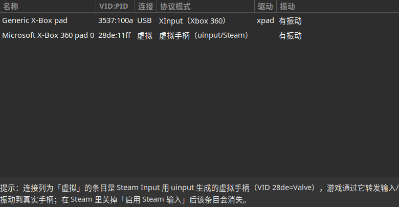

# linux-gamepad-mode-viewer

Detect the **USB protocol mode** (HID / XInput / GIP / Switch / PlayStation) and
**rumble capability** of connected game controllers on Linux.

Many controllers look identical in Steam (e.g. the GameSir G7 Pro shows up as
"Generic X-Box pad" in both GIP and XInput modes), but **only the Xbox-protocol
modes expose a rumble channel**. This tool reads the kernel's USB descriptors and
tells you which mode a controller is actually in — something input-level testers
(`jstest`, `evtest`, SDL testers) cannot see.

## Quick start (recommended: use the prebuilt executable)

The repo ships a prebuilt binary **`c/gamepad-mode-gui`** (~24 KB). No dependencies
to install — it only needs the GTK3 runtime library, which virtually every Linux
desktop already has:

```bash
./c/gamepad-mode-gui          # GTK3 window, 1 s auto-refresh, hotplug-aware, q to quit
./c/gamepad-mode-gui --text   # one-shot plain-text output
./c/gamepad-mode-gui --json   # JSON output (for scripting)
```

Example output (`--text`):

```
#  Name                        VID:PID    Link    Mode                                    Driver  Rumble
1  Generic X-Box pad          3537:109c  USB     GIP (Xbox One / Xbox Gaming Device)  xpad  yes
2  Microsoft X-Box 360 pad 0  28de:11ff  virtual virtual pad (uinput/Steam)           -     yes
```



## Build from source

Requires `gcc` + `pkg-config` + `gtk3-devel` (Fedora: `sudo dnf install gtk3-devel`):

```bash
cd c
make            # produces gamepad-mode-gui
```

## Python version (alternative, no compilation)

Pure Python 3 standard library (zero third-party deps, no root needed);
`--text` / `--json` output matches the C version:

```bash
./gamepad-mode.py            # one-shot report
./gamepad-mode.py -w         # curses live view (hotplug-aware)
./gamepad-mode.py --json     # JSON output
```

## How it works

- Enumerates joystick devices from `/proc/bus/input/devices` (including the FF
  capability bitmap).
- Resolves each device's USB interface `bInterfaceClass / SubClass / Protocol` and
  the bound driver via `/sys/devices/...` to classify the protocol mode:
  - `class ff / sub 47 / proto d0` → **GIP** (Xbox One / Xbox Gaming Device)
  - `class ff / sub 5d / proto 01` → **XInput** (Xbox 360)
  - `class 03` (HID) → generic HID (Android) — **no rumble channel**
- Bluetooth controllers are classified by driver name (`hid-nintendo`, `hid-sony`,
  `xpadneo`, ...).
- Rumble support is read from `FF_RUMBLE` (bit `0x50`) in the force-feedback bitmap,
  more precise than just "has an FF line".
- Keyboard knobs/dials that the kernel also exposes as `js*` devices are filtered
  out via their ABS axis set.

## Notes

- A row whose link/transport column shows **virtual** is not a second physical
  device: it is the virtual Xbox 360 controller that **Steam Input** creates via
  uinput (`VID 28de` = Valve). Games talk to it, and Steam forwards input and rumble
  to your real controller. Disabling Steam Input for that controller hides the row.
- xpad scales GIP rumble to at most 50% and never drives the trigger motors; XInput
  mode is full-range. Weak rumble is a driver limitation, not a hardware fault.

## Requirements

- C version: only the system GTK3 runtime (binary is prebuilt).
- Python version: Python ≥ 3.6, standard library.

## License

MIT — see [LICENSE](LICENSE).
